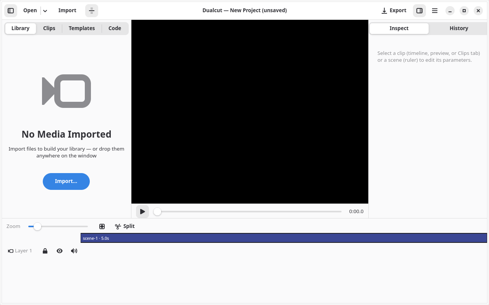
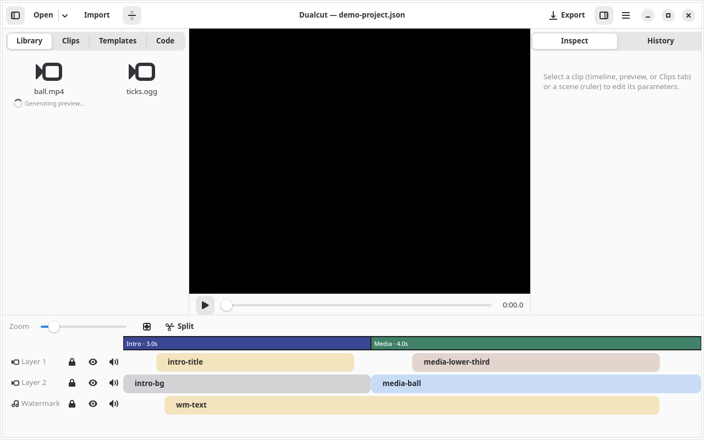
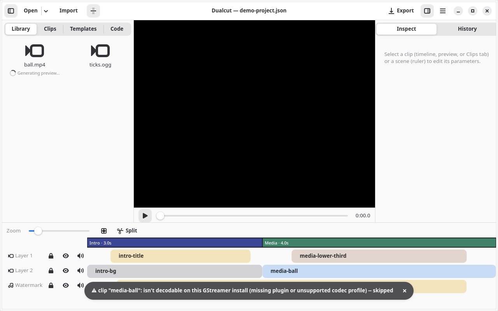
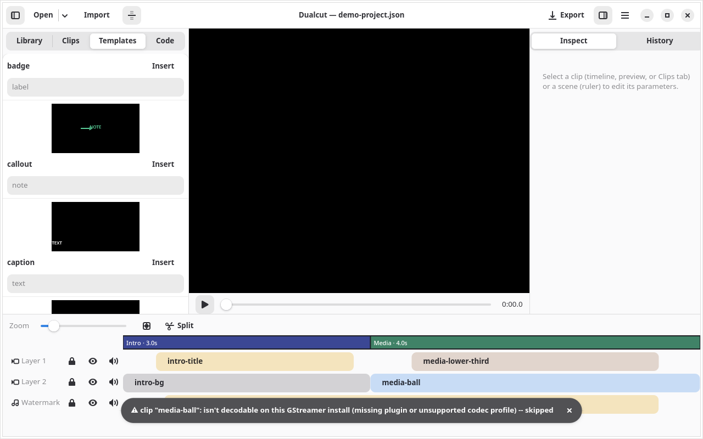
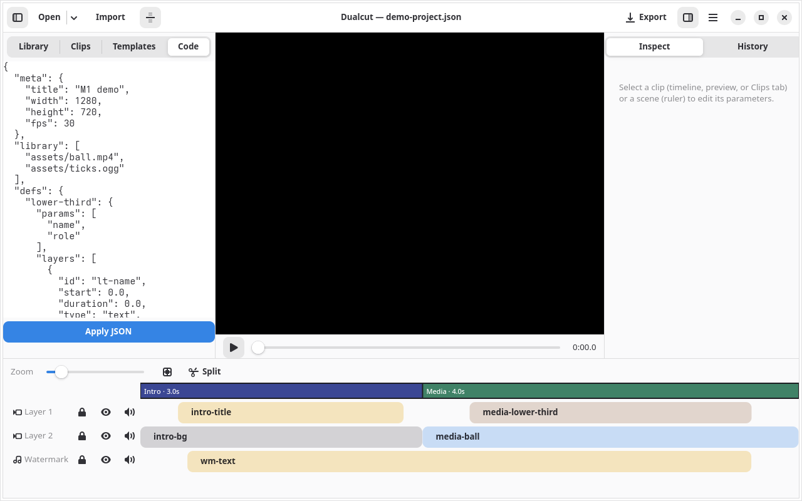
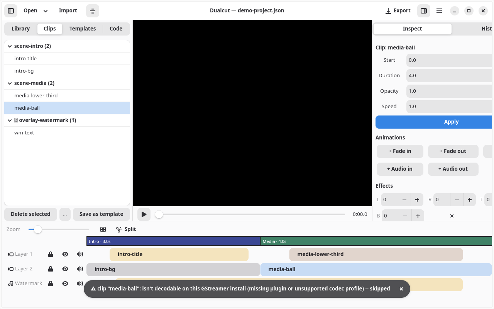
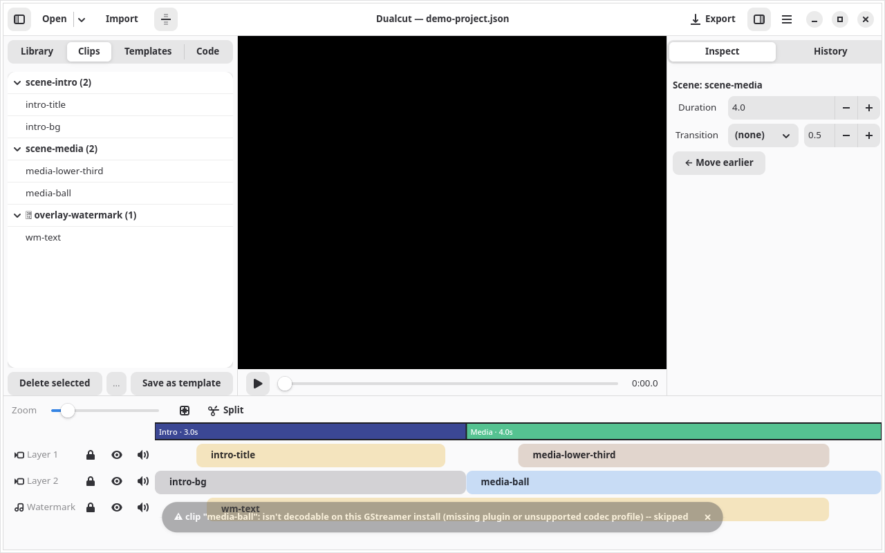
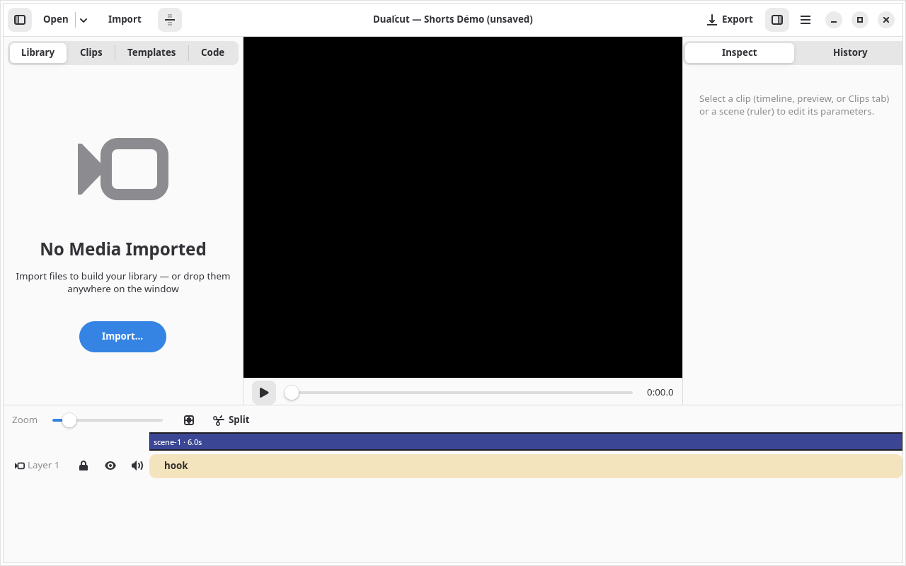
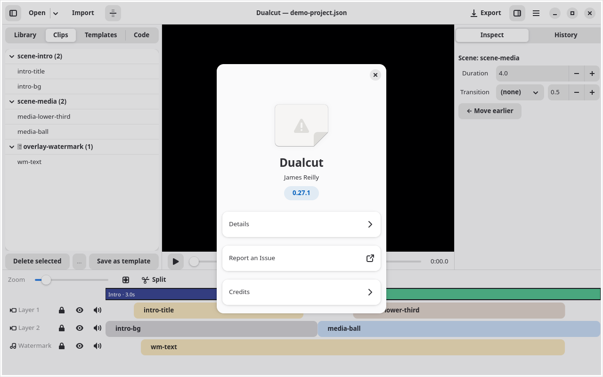

# Dualcut User Guide

The `scripts/walkthrough.sh` script (the `DUALCUT_WALKTHROUGH` mode) regenerates these screenshots on every release, so they always match the released build.

## Starting out

Launch Dualcut from your app menu. It opens an unsaved **New Project** with a title scene ready to edit. Then pick a location with *Menu → Save Project As…*. Auto-save takes over from there. Use **Open** for an existing project (the arrow shows recent projects), or pass a path on the command line: `dualcut project.json`.

## The editor

One window has four regions. The left shows the **Clips / Library / Templates / Code / Script** tabs. The middle holds the **preview** with transport controls. The right shows the **Inspector** for the selected item. A bottom pane holds the **timeline**, which you can toggle from the header bar.

Transport shortcuts: **Space** play/pause, **←/→** frame-step,
**Home** rewind, **Ctrl+Z / Ctrl+Shift+Z** undo/redo.

## Library

**Import** (from the header or the Library tab's empty state) adds media to the project's library. Or drag files from your file manager and drop them anywhere on the window. Double-click a thumbnail to insert it into the scene under the playhead; right-click for *Add to Timeline* / *Remove from Library*.

The app transcodes your imported videos into lightweight **proxy media** (960px-wide, every frame a keyframe) in the project's `.dualcut-cache/` folder. The preview and timeline scrub through these proxies for smooth playback even with 4K footage, while exports render from the original files at full quality.
Turn this off with *Use proxy media* in Preferences.

## Templates

Every reusable composition (def) in the project appears here with a rendered preview. Fill in the parameter fields and press *Insert* to instantiate it at the playhead. Make your own templates: select clips, then press *Save as template*.

## Code view

The live project JSON — the document itself. Edit it directly and press *Apply JSON*. The app validates the change, keeps it undoable, and hot-reloads the preview, exactly as if an agent edited the file on disk.

## Script

Where Code shows the document, Script *transforms* it. Write a TypeScript function `export function edit(project: Project): Project`, press *Run script*, and the returned project becomes the new document (undoable like any other edit). Useful for bulk operations — rename scenes, retime clips, and generate layers from data.

## Editing clips

Select a clip in the timeline, preview, or Inspect list. Edit its timing, transform, and text, add animation presets (fades, slides, audio fades), or hand-tune keyframes per property. Stack **effects** (blur, color) with live parameter spinners.

## Scenes and transitions

Click a scene segment to edit its duration and the transition from the previous scene: crossfade, wipes, box, iris, or clock, with an adjustable overlap. Audio blends across transitions automatically.

## Vertical / Shorts export

*New Vertical Project (9:16)* in the hamburger menu scaffolds a 1080×1920 portrait canvas for short-form/social export instead of the usual 1920×1080. Pairs with two templates. **vertical-center-crop** crops a 16:9 source to fill the portrait frame. **vertical-top-bottom-split** stacks two sources in the top and bottom halves. Both are plain composition — transform math on ordinary video clips — so they work with any project, not only ones started this way.

## Keyboard shortcuts

Space plays/pauses, Left/Right steps one frame, Home/End jumps to the start/end, and S splits the clip at the playhead. Delete ripple-deletes it, and Ctrl+Z/Ctrl+Shift+Z undo/redo. The hamburger menu's *Keyboard Shortcuts* opens a reference for whatever you have bound now — see below.

Every shortcut is rebindable in *Preferences → Keyboard Shortcuts*. Click a shortcut and press the new key combo, or pick a **preset** to match another editor. Presets only remap the actions dualcut has, and the available presets are Adobe Premiere Pro, DaVinci Resolve, Final Cut Pro, and iMovie. Where an app assumes a feature dualcut lacks, that action keeps dualcut's own default.

## Menu

The hamburger menu holds *New Project*, *New Vertical Project (9:16)*, *Save Project As…*, *Generate Captions…*, *Install Agent Skills…*, and *About*.

*Generate Captions…* transcribes the project audio locally with whisper.cpp and lands the segments as styled text clips on a Subtitles overlay track. It works out of the box in the Flatpak, which bundles a `whisper-cli` binary and a small model for English speech. Set `DUALCUT_WHISPER_MODEL` to a different ggml model to use one other than the bundled tiny.en. Outside the Flatpak, install `whisper-cli`/`whisper-cpp` on your PATH and set `DUALCUT_WHISPER_MODEL`; the action greys out until you find a whisper binary and model.

*Install Agent Skills…* sets up the dualcut skill for coding agents in `~/.agents/skills`, `~/.claude/skills`, or a directory of your choice.

## Working with agents

Everything above has a programmatic twin. The project file hot-reloads when edited, an HTTP API listens on port 7357, and TypeScript scripts run from the Script tab or the API. See [AGENTS.md](../AGENTS.md) for the document format and [CONTEXT.md](../CONTEXT.md) for the domain glossary.
